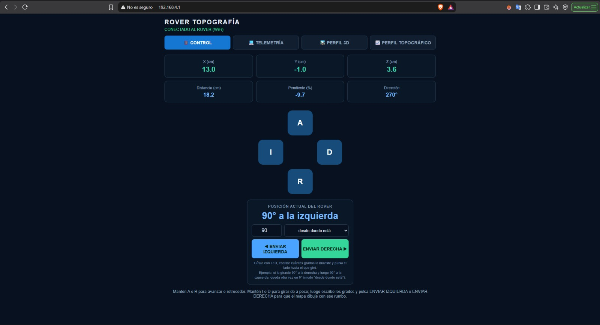
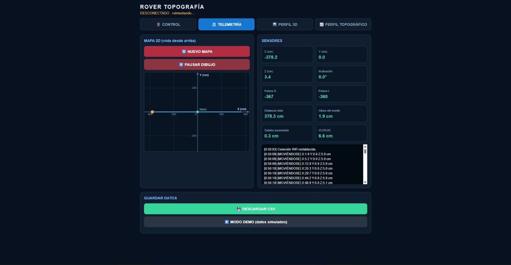
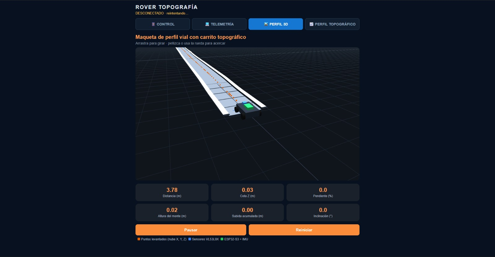
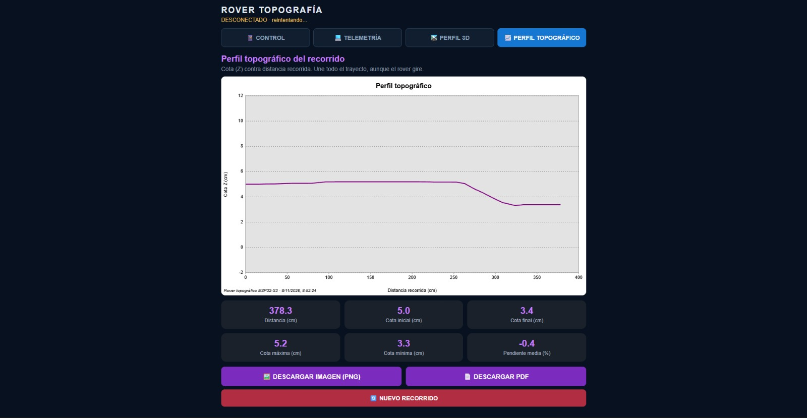
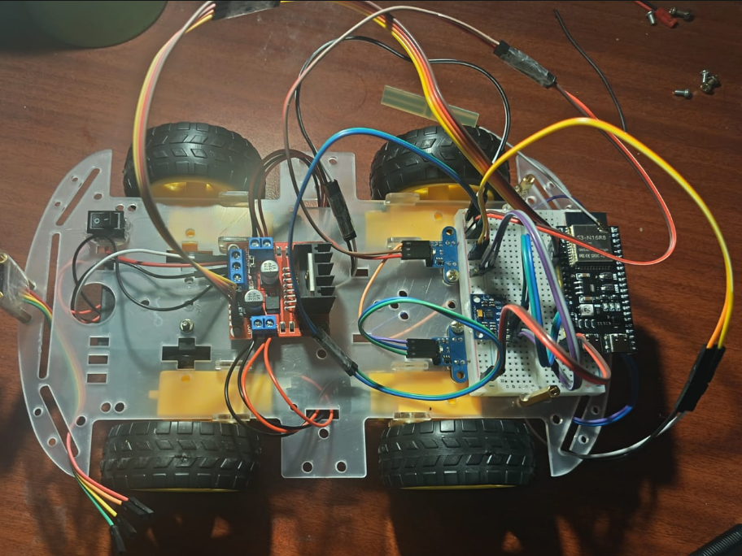
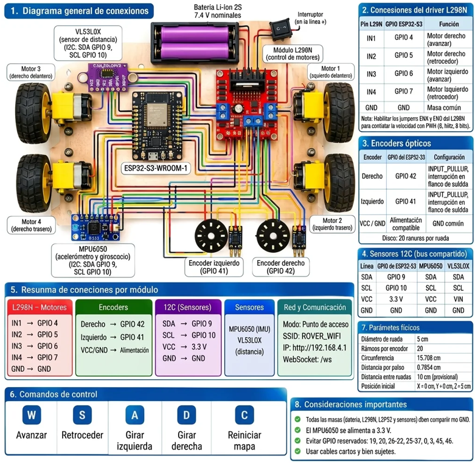

# Rover topográfico con ESP32-S3

Rover de 4 ruedas controlado desde el celular por WiFi que mide su posición en 3D (X, Y, Z) y reconstruye el perfil de un terreno con pendientes. La trayectoria se dibuja en tiempo real en un mapa 2D, en una maqueta 3D y en un perfil topográfico.

> El sistema estima el relieve por odometría e inclinación. **No reemplaza a un instrumento topográfico de precisión.**

Repositorio: <https://github.com/miraclesystems-pe/Sistema-de-Coordenadas---Rover-Topografico>

## Qué hace

- **Control remoto** desde el celular: avanza, retrocede y gira mientras se mantiene presionado el botón.
- **Distancia** medida con dos encoders ópticos (uno por lado).
- **Coordenada Z** calculada con la inclinación (pitch) del MPU6050 y la distancia recorrida.
- **Giro libre:** el carrito gira mientras mantienes presionado el botón y no mide el ángulo; tú escribes en la página cuántos grados giró (cualquier valor de 0° a 360°, no solo 90°) y el mapa dibuja con ese rumbo.
- **Interfaz web** con cuatro pestañas: Control, Telemetría, Perfil 3D y Perfil topográfico.
- **Exportación** de los datos en CSV y del perfil topográfico en PNG o PDF.
- **Modo demo** con datos simulados para probar la interfaz sin el rover.

## Estructura del proyecto

```
TuProyecto/
├── TuProyecto.ino      # Firmware del ESP32-S3
├── data/
│   ├── index.html      # Interfaz web
│   └── three.min.js    # Three.js (r149), servido localmente
└── docs/
    └── images/         # Capturas y fotografías para este README
```

La carpeta debe llamarse igual que el `.ino`, como exige el Arduino IDE.

## Hardware

| Componente | Función |
|---|---|
| ESP32-S3 (módulo N16R8) | Microcontrolador: sensores, motores, WiFi y servidor web |
| Chasis 4WD con motorreductores | Estructura y tracción (ruedas de 5 cm de diámetro) |
| Driver L298N | Controla los motores, uno por lado |
| 2 encoders ópticos (20 ranuras) | Cuentan el giro de las ruedas |
| MPU6050 | Inclinación (pitch), I2C `0x68` |
| VL53L0X | Distancia a la superficie, I2C `0x29` (dato informativo, no se usa para Z) |
| Fuente de alimentación con interruptor | Energía de motores y electrónica |

## Conexiones

**Motores (L298N)**

| Pin L298N | GPIO | Función |
|---|---|---|
| IN1 | 4 | Lado derecho, avance |
| IN2 | 5 | Lado derecho, retroceso |
| IN3 | 6 | Lado izquierdo, avance |
| IN4 | 7 | Lado izquierdo, retroceso |
| GND | GND | Masa común |

La velocidad se controla con PWM directo sobre IN1–IN4 (1 kHz, 8 bits), por lo que ENA y ENB deben tener el jumper puesto.

**Encoders:** salida del derecho en GPIO 42 y del izquierdo en GPIO 41 (`INPUT_PULLUP`, interrupción en flanco de subida).

**Sensores I2C** (MPU6050 y VL53L0X comparten el bus, a 100 kHz): SDA en GPIO 9, SCL en GPIO 10, alimentación a 3,3 V.

**Recomendaciones**

- Todas las masas (batería, L298N, ESP32, sensores) deben compartir el mismo GND.
- Usa cables cortos y bien sujetos en el bus I2C: los cables largos o sueltos dieron lecturas erróneas.
- Fija el MPU6050 **plano** y alineado con el eje longitudinal del carrito.
- Se evitaron los GPIO reservados del ESP32-S3: 19 y 20 (USB), 26–32 (flash), 35–37 (PSRAM) y 0, 3, 45, 46 (arranque).

## Instalación

**1. Arduino IDE.** Instala el soporte para ESP32 y selecciona la placa **ESP32S3 Dev Module**.

**2. Librerías**

- ESPAsyncWebServer y AsyncTCP
- ArduinoJson
- Adafruit_VL53L0X
- Wire y LittleFS (incluidas con el soporte de ESP32)

**3. Cargar el firmware.** Abre `TuProyecto.ino` y súbelo a la placa. El Monitor Serie va a 115200 baudios.

**4. Cargar la página.** Sube la carpeta `data` a la memoria flash con la herramienta de subida de LittleFS. Elige un esquema de particiones que incluya espacio para LittleFS. El firmware y la carpeta `data` se cargan por separado: si cambias uno, vuelve a cargar solo ese.

**5. Encender con el carrito quieto y plano.** Al arrancar se calibra el giroscopio y el nivel de referencia, así que no lo muevas hasta que termine.

## Uso

1. Conecta el celular a la red WiFi **`ROVER_WIFI`** (contraseña `12345678`, definida en el firmware; cámbiala si lo vas a usar fuera de pruebas).
2. Abre **<http://192.168.4.1>** en el navegador.
3. En la pestaña **Control**:
   - Mantén **A** para avanzar o **R** para retroceder. Al soltar, se detiene.
   - Mantén **I** para girar a la izquierda o **D** para girar a la derecha.
   - Suelta el botón cuando el carrito apunte hacia donde quieres. Luego escribe cuántos grados lo giraste (cualquier ángulo, por ejemplo 30° o 72°) y pulsa **ENVIAR IZQUIERDA** o **ENVIAR DERECHA** según el lado hacia el que giró.
4. Mira el recorrido en **Telemetría**, el terreno en **Perfil 3D** y la cota contra la distancia en **Perfil topográfico**.
5. Usa el botón de reiniciar para empezar un mapa nuevo. El carrito toma su inclinación actual como suelo plano.

### Cómo se envía el giro

El giro **no se mide**: el firmware solo mueve los motores mientras mantienes presionado **I** o **D**, y el ángulo lo escribes tú. No hay un giro fijo de 90°: puedes usar cualquier ángulo.

1. Mantén **I** o **D** hasta que el carrito apunte hacia donde quieres. El giro arranca con poca potencia y sube de forma gradual, y al soltar el botón frena y se detiene.
2. Escribe en la casilla cuántos grados giró (de 0 a 360).
3. Pulsa **ENVIAR IZQUIERDA** o **ENVIAR DERECHA** según el lado hacia el que giró. La página calcula el nuevo rumbo y se lo envía al rover con el comando `G<grados>`.

El selector junto a la casilla define desde dónde se cuentan los grados:

| Modo | Significado | Ejemplo |
|---|---|---|
| Desde donde está | Suma (derecha) o resta (izquierda) al rumbo actual | Giró 30° a la derecha y luego 30° a la izquierda: vuelve a 0° |
| Desde el inicio (0°) | Se mide siempre desde la línea de arranque | Derecha 30 da 30°; izquierda 30 da 330° |

Detalles del giro:

- Mientras gira, el mapa **no se mueve**, y los pulsos de los encoders durante el giro no cuentan como avance ni como distancia recorrida.
- Mientras no envíes un giro, el mapa sigue dibujando con el rumbo anterior. Una flecha naranja en el mapa 2D muestra el rumbo actual.
- El rover solo acepta el rumbo enviado cuando está detenido; si se está moviendo, ignora el comando.
- El rumbo se guarda sin conversiones y siempre queda entre 0° y 360°. El botón de reiniciar lo regresa a 0°.

## Rumbo y coordenadas

El rumbo es una brújula medida desde el eje +X del mapa, y es el mismo número en el firmware, el Monitor Serie y la página. La tabla muestra algunos ejemplos, pero sirve cualquier ángulo:

| Giro | Rumbo | Hacia dónde dibuja |
|---|---|---|
| Al frente | 0° | +X |
| Derecha 30° | 30° | Ligeramente hacia Y negativo |
| Derecha 45° | 45° | Diagonal hacia Y negativo |
| Derecha 90° | 90° | Y negativo (cuarto cuadrante) |
| Izquierda 90° | 270° | Y positivo |
| Izquierda 45° | 315° | Diagonal hacia Y positivo |
| Izquierda 30° | 330° | Ligeramente hacia Y positivo |

Con el rumbo ψ y el avance horizontal d:

```
X ← X + d · cos ψ
Y ← Y − d · sin ψ
```

## Cómo se calcula

**Distancia.** Cada pulso del encoder equivale a:

```
cm por pulso = (π · D / N) · F        D = 5 cm · N = 20 ranuras · F = 1,325
```

El avance es el promedio de ambos lados, con signo (suma al avanzar, resta al retroceder). F es el factor de calibración: para ajustarlo, `F_nuevo = F_actual × (distancia real / distancia medida)`.

**Inclinación y cota Z.** El pitch sale de un filtro complementario que combina la integración del giroscopio con una corrección lenta del acelerómetro (solo cuando mide cerca de 1 g). Cada tramo se descompone en una parte horizontal y una vertical:

```
d_horizontal = d · cos(pitch)        d_vertical = d · sin(pitch)        Z ← Z + d_vertical
```

El VL53L0X no sirve para calcular Z en una pendiente, porque mide la distancia perpendicular al chasis y esa casi no cambia al subir.

| Magnitud | Cómo se obtiene |
|---|---|
| Distancia recorrida | Suma de los tramos medidos por los encoders |
| Cota Z | Z0 + suma de d · sen(pitch) |
| Pendiente (%) | tan(pitch) × 100 |
| Altura del monte | Z máxima − Z mínima |
| Subida acumulada | Suma de los incrementos positivos de Z |

## Comunicación

- WebSocket en `/ws`: el rover envía la telemetría en JSON cada 200 ms.
- Comandos de texto: `A` avanzar · `R` retroceder · `I` girar izquierda · `D` girar derecha · `S` parar · `C` reiniciar mapa · `G<grados>` fijar el rumbo (por ejemplo `G90.0`).
- Mientras un botón (A, R, I o D) está presionado, la página repite el comando cada 150 ms. Si el firmware no recibe señal durante 400 ms, detiene los motores solo, también durante un giro.

**Campos de la telemetría**

| Campo | Descripción |
|---|---|
| `x`, `y`, `z` | Posición en cm |
| `heading` | Rumbo en grados (0–360), como brújula |
| `pitch`, `pendientePct` | Inclinación en grados y pendiente en % |
| `zMax`, `zMin`, `subidaTotal` | Cotas máxima y mínima y subida acumulada (cm) |
| `pulsosDerecha`, `pulsosIzquierda` | Pulsos acumulados de cada encoder |
| `distanciaTotal` | Distancia recorrida (cm) |
| `distanciaSuperficie` | Lectura del VL53L0X (cm) |
| `moviendo`, `girando` | Estado del movimiento |

## Parámetros de ajuste

Se definen al inicio de `TuProyecto.ino`:

| Constante | Valor | Efecto |
|---|---|---|
| `VEL_AVANCE` | 100 (de 255) | PWM al avanzar y retroceder |
| `VEL_GIRO` | 130 (de 255) | PWM máximo al girar |
| `PWM_ARRANQUE_GIRO` | 70 | PWM con el que empieza el giro |
| `RAMPA_GIRO_MS` | 400 ms | Tiempo de la subida gradual del PWM al girar |
| `LATIDO_MS` | 400 ms | Tiempo sin señal tras el cual se detiene solo |
| `FRENO_MS` | 40 ms | Duración del freno activo |
| `FACTOR_CALIB` | 1,325 | Calibración de la distancia |
| `SIGNO_AVANCE` | 1 | Cámbialo a −1 si X disminuye al avanzar |
| `PITCH_SIGN` | 1 | Cámbialo a −1 si la pendiente sale con signo invertido |
| `PITCH_MUERTO` | 1,5° | Zona muerta de la inclinación |
| `K_ACEL_MOV` / `K_ACEL_QUIETO` | 0,01 / 0,10 | Corrección del acelerómetro en movimiento y en reposo |
| `TOL_1G` | 0,05 | Tolerancia alrededor de 1 g para usar el acelerómetro |
| `Z0_CM` | 5 cm | Cota inicial |

## Solución de problemas

| Problema | Posible causa | Qué hacer |
|---|---|---|
| El rumbo sale invertido (270° al girar a la derecha) | Firmware y página de versiones distintas | Vuelve a cargar el `.ino` **y** la carpeta `data`, y recarga el navegador con Ctrl+F5 |
| La página no abre o el 3D no carga | No se subió `data` o falta `three.min.js` | Sube la carpeta `data` con LittleFS. La red del rover no tiene internet, por eso Three.js es local |
| Lecturas absurdas del MPU6050 o «Error I2C» | Contactos intermitentes o cables largos | Revisa 3,3 V y GND, acorta y sujeta los cables |
| X disminuye al avanzar | Sentido de conteo invertido | Cambia `SIGNO_AVANCE` a −1 |
| La pendiente sale con signo contrario | Montaje o eje del MPU6050 | Cambia `PITCH_SIGN` a −1 |
| El giro no tiene fuerza | Rozamiento del suelo o batería baja | Revisa la batería y sube `VEL_GIRO` |
| El ESP32-S3 se reinicia en bucle | El programa se cuelga en `setup()` | Revisa los mensajes numerados del Monitor Serie y los interruptores `USAR_*` para aislar módulos |

## Limitaciones

- **Error acumulado en Z:** la altura se obtiene integrando la inclinación, por lo que el error crece con la distancia.
- **Deslizamiento:** si las ruedas patinan, los encoders cuentan más distancia de la real.
- **Vibración:** los motores perturban el acelerómetro; se mitiga con el filtro y la zona muerta.
- **Rumbo manual:** como el giro no se mide, la precisión del rumbo depende del ángulo que escribas.
- **Driver L298N:** controla por lado, no por rueda, y su torque es limitado.

## Trabajo futuro

Las siguientes mejoras se plantean como ampliaciones del prototipo; no forman parte de las funciones implementadas actualmente.

- **Incorporar una cámara:** añadir una cámara frontal para registrar imágenes del terreno y del recorrido. En una etapa posterior, las imágenes podrían procesarse para complementar la reconstrucción visual de la superficie.
- **Calcular el área recorrida o delimitada:** permitir que el usuario marque los vértices de una zona durante el recorrido y calcular su área aproximada a partir de las coordenadas X e Y. Esta función no requiere una cámara, pero sí cerrar correctamente el contorno y considerar el error de odometría.
- **Mejorar las ruedas:** utilizar ruedas de goma con mayor agarre y, si el terreno lo requiere, un diámetro o diseño de banda de rodadura más adecuado para reducir el deslizamiento.
- **Mejorar la medición de altura:** incorporar un sensor de distancia o profundidad orientado hacia el terreno y montado de forma estable. Sus lecturas deberán calibrarse y combinarse con la posición del rover para obtener muestras de elevación.
- **Mejorar la orientación:** integrar una medición de rumbo más confiable para reducir la dependencia del ángulo ingresado manualmente durante los giros.
- **Controlar cada rueda por separado:** reemplazar el L298N por drivers que permitan regular individualmente los motores y mejorar el control de dirección y velocidad.
- **Añadir posicionamiento GNSS:** estudiar la incorporación de un receptor GNSS; para obtener mayor precisión en exteriores se podría evaluar una solución RTK, considerando su costo y las condiciones de recepción.
- **Implementar recorridos automáticos:** generar trayectorias paralelas para cubrir una zona de forma ordenada y reducir las áreas sin medición.
- **Guardar los datos en una tarjeta microSD:** almacenar coordenadas, inclinación, distancia y lecturas de sensores para analizarlas posteriormente sin depender de la conexión con la interfaz.
- **Generar modelos topográficos más completos:** procesar varias pasadas para crear una malla 3D, mapas de elevación, curvas de nivel y estimaciones de volumen.

## Registro fotográfico y resultados

En esta sección se pueden incorporar fotografías y capturas del prototipo para documentar su construcción, conexiones y funcionamiento. Reemplaza las rutas de ejemplo por las imágenes que agregues al repositorio.

> **Organización sugerida:** guarda las imágenes dentro de una carpeta llamada `docs/images/`. Utiliza nombres descriptivos y evita espacios o tildes en los nombres de archivo.

### 1. Interfaz web del rover

Capturas de las pestañas de control, telemetría, perfil 3D y perfil topográfico.

| Control del rover | Telemetría |
|---|---|
|  |  |

| Perfil 3D | Perfil topográfico |
|---|---|
|  |  |

### 2. Carrito construido

Fotografías del prototipo terminado desde diferentes ángulos. Se recomienda mostrar la vista superior, frontal y lateral.



### 3. Conexiones electrónicas

Incluye un diagrama general del cableado y, si es necesario, fotografías cercanas de las conexiones del ESP32-S3, el driver L298N y los sensores.



### 4. Herramientas y materiales

Fotografías de los componentes y herramientas utilizados durante el ensamblaje y las pruebas. Por ejemplo: ESP32-S3, L298N, encoders, MPU6050, VL53L0X, batería, cables, cautín, multímetro y herramientas de montaje. Ajusta esta lista a los materiales que realmente utilizaste.


### 5. Pruebas y resultados

Agrega evidencias de las pruebas realizadas, como el desplazamiento sobre una superficie plana, el recorrido sobre una pendiente y la visualización de las coordenadas o del perfil del terreno.

| Prueba en superficie plana | Prueba en pendiente |
|---|---|
|  |  |


